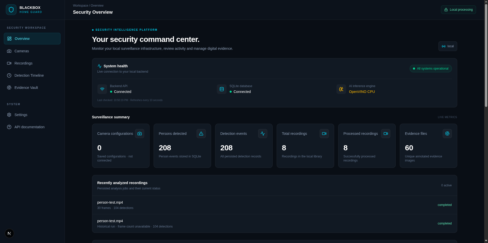
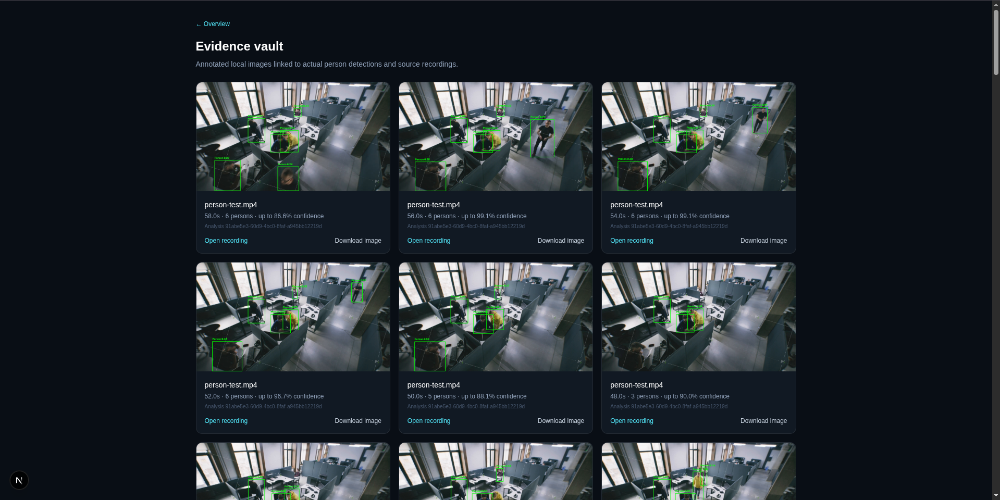

# Blackbox Home Guard

Local video recording management and person detection for Linux. Uploaded footage and inference stay on the host; the application does not use hosted AI services. SHA-256 fingerprints are recorded for uploaded originals. These fingerprints detect later file changes but do not by themselves prove a recording's source or chain of custody.

## Implemented capabilities

- FastAPI API with SQLite recording and detection records.
- Local video upload (up to 2 GiB), FFprobe validation, metadata extraction, preview frames and SHA-256 fingerprinting.
- Separate H.264/AAC playback copy for media that is not browser compatible. The uploaded original remains intact. Video streaming supports HTTP byte ranges.
- OpenVINO `person-detection-0202` FP16 CPU inference, sampled analysis, confidence scores, annotated evidence, and timestamp navigation.
- Dashboard metrics for recordings, people, events, recent analyses, service health, and local storage.
- Recording library and details with search, status filters, sort controls, upload progress, playback, metadata, and SHA-256 fingerprints.
- Detection timeline filters and timestamp navigation; evidence gallery groups detections by frame and provides a larger viewer.
- Recording deletion with path validation and cascade cleanup of its analyses, detections, and stored evidence.
- Persistent queued/running/completed/failed analysis records, progress polling, and duplicate-analysis protection.
- Local camera source configuration records with input validation; configurations are not tested and do not start live capture.

Live camera/RTSP capture, user authentication, alerts, and remote access controls are not implemented. Do not expose the development server to untrusted networks. Local-only processing does not protect data from other users or devices that can access the host.

## Screenshots

### Dashboard



### Evidence gallery



## Requirements

- Kali Linux or another Linux host, Python 3.10+, Node.js/npm.
- FFmpeg and FFprobe on `PATH` (`sudo apt install ffmpeg`).
- The OpenVINO FP16 model at `backend/models/person-detection-0202/FP16/` (the model is currently included in this checkout).

## Setup and run

From the repository root:

```bash
python3 -m venv .venv
source .venv/bin/activate
python -m pip install -r backend/requirements.txt
ffmpeg -version
ffprobe -version
```

Start the API in one terminal:

```bash
source .venv/bin/activate
uvicorn app.main:app --app-dir backend --host 127.0.0.1 --port 8000
```

Start the frontend in another terminal:

```bash
cd frontend
npm ci
cp .env.example .env.local
npm run dev
```

Open <http://localhost:3000>. API health is at <http://127.0.0.1:8000/api/v1/health>; interactive API documentation is at <http://127.0.0.1:8000/docs>.

Set `NEXT_PUBLIC_API_URL` in `frontend/.env.local` if the API is served from a different local address. The default is `http://127.0.0.1:8000`. The API CORS allowlist currently permits localhost and 127.0.0.1 on port 3000.

## Workflow

1. Open **Recordings** and upload a supported video (`mp4`, `mov`, `mkv`, `avi`, `webm`, `m4v`, `mpeg`, or `mpg`). The API validates that the file contains a video stream, extracts metadata and preview frames, and stores the uploaded original under `backend/data/recordings/`.
2. Open the recording, review the original metadata and fingerprint, and play it through the byte-range endpoint. If needed, playback uses a separately stored browser-compatible copy.
3. Choose a sample interval (1, 2, 5, or 10 seconds) and queue local person analysis. The API returns an analysis ID immediately; progress and results are persisted in SQLite and shown on the recording page and dashboard.
4. Review detections in the recording, detection timeline, or evidence vault. Evidence is retrieved through API routes; absolute storage paths are not returned to the frontend.

## API overview

| Method | Route | Purpose |
|---|---|---|
| GET | `/api/v1/health` | API/database health and local-processing mode |
| GET | `/api/v1/system/info` | Runtime engines, model availability, and storage capacity |
| GET | `/api/v1/dashboard` | Real recording, detection, evidence, and recent activity counters |
| GET | `/api/v1/cameras` | List saved camera configurations (connectivity is not tested) |
| POST | `/api/v1/cameras` | Save a validated RTSP or local device source |
| POST | `/api/v1/recordings` | Upload a video as multipart field `file` |
| GET | `/api/v1/recordings` | List recordings |
| GET | `/api/v1/recordings/{id}` | Recording metadata |
| DELETE | `/api/v1/recordings/{id}` | Remove a recording and cascade its analyses/detections/evidence |
| GET | `/api/v1/recordings/{id}/video` | Original or compatible playback stream; supports `Range` |
| GET | `/api/v1/recordings/{id}/frames` | List extracted frame URLs |
| POST | `/api/v1/recordings/{id}/analyze?interval_seconds=2` | Queue a local sampled person analysis (202) |
| GET | `/api/v1/recordings/{id}/analyses` | List persisted analysis runs and status |
| GET | `/api/v1/analyses/{analysis_id}` | Poll analysis progress and retrieve results |
| GET | `/api/v1/recordings/{id}/detections?analysis_id=...` | List detections for a recording or analysis |
| GET | `/api/v1/detections?limit=100&offset=0` | Paginated global detection timeline |
| GET | `/api/v1/evidence?limit=200&offset=0` | Paginated evidence gallery, grouped by annotated frame |
| GET | `/api/v1/recordings/{id}/detections/{event_id}/evidence` | Retrieve an annotated JPEG |

The database is initialized additively at `backend/data/blackbox.db`; existing rows are preserved during schema upgrades. Recordings, playback copies, extracted frames, and analysis evidence are stored in per-recording folders under `backend/data/recordings/`. Back up both locations together. Deleting a recording removes its folder and cascades its analysis, detection, and evidence records. Analysis work is in-process and should run with one Uvicorn worker; queued work is not durable across process crashes. No automatic retention job is configured.

## Checks

```bash
# Backend syntax
.venv/bin/python -m py_compile backend/app/main.py backend/app/core/*.py

# Existing local detector verification (uses sample_videos/person-test.mp4)
PYTHONPATH=backend .venv/bin/python backend/test_person_detection.py

# Frontend static checks
cd frontend
npx tsc --noEmit
npm run lint
npm run build -- --webpack
```

The sample detector script exercises the existing model without uploading duplicate footage. The normal Turbopack production build may require spawning a helper process; `--webpack` uses Next.js's supported webpack build path.

## Troubleshooting and limitations

- **API unavailable:** start the backend and verify port 8000; check `NEXT_PUBLIC_API_URL`.
- **Upload rejected:** verify the extension, that the media contains a decodable video stream, and that it is below 2 GiB. FFmpeg/FFprobe must be installed.
- **Playback unsupported:** inspect the playback status in recording details. Conversion failure preserves the original but can leave it unplayable in that browser.
- **Model unavailable:** confirm the XML and BIN files exist at the model path and that the installed OpenVINO runtime supports CPU inference.
- **Slow analysis:** processing runs in a background task so other API routes remain responsive, but inference still samples frames sequentially. Select a wider interval for long footage.
- **Cameras:** configuration and live monitoring are not implemented; the camera page reports this instead of presenting a fake feed.

## Project structure

```text
backend/app/main.py                 FastAPI routes, SQLite schema and migrations
backend/app/core/video_processor.py FFmpeg/FFprobe, hashes, playback and frames
backend/app/core/person_detector.py OpenVINO person detector
backend/app/core/video_analyzer.py  sampled video analysis and annotated evidence
backend/data/                       local database and footage storage
backend/models/                     local OpenVINO model
frontend/src/app/                   Next.js dashboard and workflows
sample_videos/                      local verification footage
```
